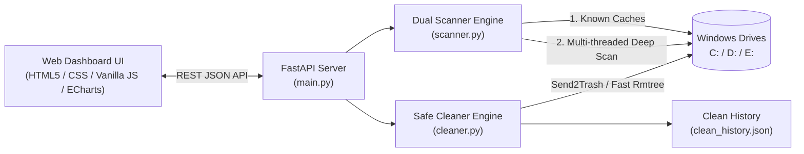

# ⚡ DiskPulse — Smart Disk Analyzer & Cleaner for Developers


**DiskPulse** là công cụ phân tích dung lượng ổ đĩa và dọn rác thông minh được thiết kế chuyên biệt cho **Lập trình viên (Developers) & Power Users trên Windows**.

Khác với các công cụ truyền thống như *WinDirStat* hay *TreeSize* (chỉ cho biết thư mục nào nặng nhưng không cho biết **xóa có làm hỏng máy hay dự án không**), **DiskPulse** tự động phân loại mức độ an toàn theo hệ thống đèn giao thông (**Safe / Caution / Review**), giải thích rõ ràng bằng tiếng Việt lý do tại sao xóa được và điều gì xảy ra sau khi xóa.

---

## 🌟 Tính Năng Nổi Bật

### 1. Bộ Máy Quét Kép Đa Luồng (Dual-Engine Multi-Threaded Scanner)
* **Quét Nhanh Hệ Thống & Ứng Dụng (Known Caches & Temp):**
  * **Windows System:** `%TEMP%`, `C:\Windows\Temp`, `SoftwareDistribution\Download` (Windows Update Cache), `CrashDumps`, `Windows Error Reporting (WER)`, `Explorer Thumbnail Cache`, `NVIDIA DXCache / GLCache`, `Direct3D Shader Cache`.
  * **Trình duyệt & Ứng dụng:** Google Chrome, Microsoft Edge, Brave, Cốc Cốc (`Cache`, `Code Cache`, `Service Worker CacheStorage`), VS Code (`CachedData`, `CachedExtensionVSIXs`, `Cache`), Discord, Zalo PC, CapCut PC...
  * **Global Developer Caches:** `pip`, `uv`, `conda / anaconda pkgs`, `npm-cache`, `yarn`, `pnpm-store`, `nuget`, `gradle`, `maven (.m2)`, `cargo`, `go-build`, `HuggingFace Hub`, `PyTorch Hub`, `Playwright / Puppeteer`...
  * **Thư mục `Downloads`:** Tự động lọc các file bộ cài đặt cũ (`.exe`, `.msi`, `.iso`, `.vsix`) và file nén lớn (`.zip`, `.rar`, `.7z`).
* **Quét Sâu Toàn Bộ Ổ Đĩa (`C:`, `D:`, `E:`...) & Gom Cụm Thông Minh:**
  * Sử dụng `os.scandir` kết hợp `ThreadPoolExecutor` giúp quét hơn **1.2 triệu file chỉ trong ~18 giây**.
  * **Smart Cluster Aggregation:** Khi bắt gặp các thư mục phụ thuộc/biên dịch của dự án (`node_modules`, `.venv`, `venv`, `target`, `dist`, `build`, `.next`, `.nuxt`, `.svelte-kit`, `.gradle`, `obj`, `__pycache__`, `.pytest_cache`, `.mypy_cache`, `.ruff_cache`, `.turbo`...), công cụ tự động gom thành **1 cụm duy nhất** và tính tổng dung lượng thay vì làm treo giao diện với hàng trăm nghìn file lẻ.
  * **Stale Project Detection (Kiểm tra độ tuổi dự án):** Tự động kiểm tra thời điểm chỉnh sửa mã nguồn gần nhất của dự án. Nếu dự án đã **$\ge 14$ ngày** (tùy chỉnh được) không đụng tới, công cụ sẽ gợi ý dọn `node_modules` / `.venv` ở mức **An toàn tuyệt đối**.

### 2. Phân Loại 3 Mức Độ An Toàn (Traffic Light System)

| Mức độ | Nhãn hiển thị | Ý nghĩa & Tiêu chí phân loại |
| :--- | :--- | :--- |
| 🟢 **Safe** | **An toàn tuyệt đối** | Xóa ngay lập tức mà không mất dữ liệu hay ảnh hưởng hệ điều hành/code (Temp, Browser Cache, Global Package Cache, `__pycache__`, `node_modules`/`.venv` của các dự án cũ không sửa code $\ge 14$ ngày). |
| 🟡 **Caution** | **Cần lưu ý** | Xóa được nhưng cần lưu ý: `node_modules`/`.venv` của dự án đang làm việc gần đây ($< 14$ ngày), kho `conda/pkgs` hoặc `pnpm-store` dùng hardlink, cache model AI (`HuggingFace`), file nén trong `Downloads`. |
| 🔴 **Review** | **Xem xét thủ công** | Các file dữ liệu đơn lẻ có dung lượng lớn ($\ge 100\text{ MB}$, tùy chỉnh được) hoặc ổ đĩa ảo WSL2/Docker (`.vhdx`) cần người dùng kiểm tra trực tiếp trước khi quyết định. |

### 3. Cơ Chế Bảo Vệ & Dọn Dẹp An Toàn Đa Tầng
* **2 Chế độ xóa linh hoạt:**
  * 🗑️ **Đưa vào Thùng Rác (`Recycle Bin`):** Mặc định an toàn, có thể khôi phục lại bất cứ lúc nào.
  * ⚡ **Xóa Vĩnh Viễn Siêu Tốc (`Permanent Delete`):** Tối ưu để xóa nhanh các thư mục `node_modules` có hàng chục nghìn file nhỏ hoặc khi ổ đĩa đã đầy 100% (0 byte trống).
* **Hard Blocklist (Chốt chặn bảo vệ cứng):**
  * Chặn tuyệt đối mọi thao tác xóa vào thư mục gốc ổ đĩa (`C:\`, `D:\`), `C:\Windows\System32`, `SysWOW64`, `WinSxS`, `Program Files`, thư mục lịch sử Git (`.git`) và các gói nội bộ của ứng dụng Electron đã cài đặt (`\resources\app`).
  * Tự động bỏ qua các file đang được tiến trình khác mở khóa (locked files) trong `%TEMP%` mà không làm gián đoạn quá trình dọn dẹp.
* **Kiểm chứng trực tiếp:** Nút **"Explorer"** tại từng dòng giúp mở ngay Windows File Explorer và bôi đậm chính xác file/thư mục đó trên máy.
* **Zero `node_modules` Overhead:** Giao diện Web Dashboard được xây dựng bằng HTML5 + CSS + Vanilla JS + Apache ECharts, không cần bước build Node.js và không tự sinh thêm hàng trăm MB `node_modules` trên chiếc máy đang đầy ổ đĩa của bạn.

---

## 🏗️ Kiến Trúc Hệ Thống



### Cấu trúc thư mục
```text
📦 DiskPulse
 ┣ 📜 main.py                      # FastAPI Server & REST API endpoints
 ┣ 📜 scanner.py                   # Bộ máy quét đa luồng & phân loại mức độ an toàn
 ┣ 📜 cleaner.py                   # Bộ máy dọn dẹp an toàn, Hard Blocklist & Explorer integration
 ┣ 📂 static/
 ┃ ┣ 📜 index.html                 # Giao diện Web Dashboard chính
 ┃ ┣ 📜 styles.css                 # Hệ thống thiết kế UI tối ưu cho Operate Mode
 ┃ ┗ 📜 app.js                     # Logic điều khiển Frontend, bộ lọc, bảng dữ liệu & ECharts Treemap
 ┣ 📜 requirements.txt             # Danh sách thư viện Python cần thiết
 ┣ 📜 run.bat                      # Script khởi chạy nhanh 1-click trên Windows (Conda)
 ┣ 📜 AGENTS.md                    # Quy tắc vận hành & kiến trúc dành cho AI Agent
 ┗ 📜 PROJECT_HANDOVER_STATUS.md   # Tài liệu theo dõi tiến độ dự án
```

---

## 🚀 Hướng Dẫn Cài Đặt & Sử Dụng

### Yêu cầu hệ thống
* Hệ điều hành: **Windows 10 / Windows 11**
* Môi trường: **Python 3.9+** (Khuyến nghị sử dụng **Conda** hoặc `venv`)

### Cách 1: Chạy trên môi trường Conda (Khuyến nghị)
1. Cài đặt các thư viện phụ thuộc vào môi trường Conda `base`:
   ```powershell
   conda run -n base --no-capture-output pip install -r requirements.txt
   ```
2. Khởi chạy ứng dụng:
   * **Nhấp đúp trực tiếp** vào file `run.bat`, hoặc chạy lệnh:
   ```powershell
   conda run -n base --no-capture-output python main.py
   ```
3. Mở trình duyệt và truy cập: **`http://127.0.0.1:8765`**

### Cách 2: Chạy bằng Python tiêu chuẩn
```powershell
pip install -r requirements.txt
python main.py
```

---

## 🔌 Danh Sách REST API Endpoints

| Phương thức | Endpoint | Mô tả |
| :--- | :--- | :--- |
| `GET` | `/api/drives` | Lấy danh sách các phân vùng ổ đĩa (`C:`, `D:`...) kèm dung lượng tổng, đã dùng và còn trống. |
| `POST` | `/api/scan/start` | Bắt đầu tiến trình quét đa luồng với cấu hình tùy chọn (`drives`, `large_file_mb`, `stale_project_days`). |
| `POST` | `/api/scan/stop` | Dừng tiến trình quét đang chạy ngay lập tức và giữ lại kết quả đã tìm thấy. |
| `GET` | `/api/scan/status` | Lấy trạng thái quét theo thời gian thực, thống kê dung lượng theo nhóm rủi ro/danh mục và danh sách các mục. |
| `POST` | `/api/clean` | Thực thi dọn dẹp danh sách `item_ids` theo chế độ `recycle` (Thùng rác) hoặc `permanent` (Xóa vĩnh viễn). |
| `POST` | `/api/open-explorer` | Mở Windows File Explorer và trỏ trực tiếp tới đường dẫn file/thư mục được chọn. |
| `GET` | `/api/history` | Lấy lịch sử các phiên đã dọn dẹp và số GB đã giải phóng. |

---

## 🛡️ Cam Kết An Toàn Dữ Liệu (Safety Guarantees)
1. **Không bao giờ xóa mã nguồn (`.py`, `.ts`, `.js`, `.cs`...) hay lịch sử Git (`.git`)**: Bộ quét chỉ nhắm vào thư mục phụ thuộc/biên dịch có thể tái tạo (`node_modules`, `.venv`, `__pycache__`, `target`...) và chỉ gom cụm khi phát hiện file định danh dự án hợp lệ (`package.json`, `requirements.txt`, `pyproject.toml`, `Cargo.toml`...).
2. **Bảo vệ ứng dụng đã cài đặt**: Tự động bỏ qua `Program Files`, `Program Files (x86)`, `AppData` (ngoại trừ các thư mục Cache đã được định danh chính xác) và các thư mục `\resources\app` của ứng dụng Electron.
3. **Xác nhận 2 bước (2-Step Inline Confirmation)**: Nút dọn dẹp yêu cầu bấm xác nhận rõ ràng trước khi thực thi để tránh thao tác nhầm.

---

## 📄 Giấy Phép (License)
Dự án được phân phối dưới giấy phép **MIT License**.
